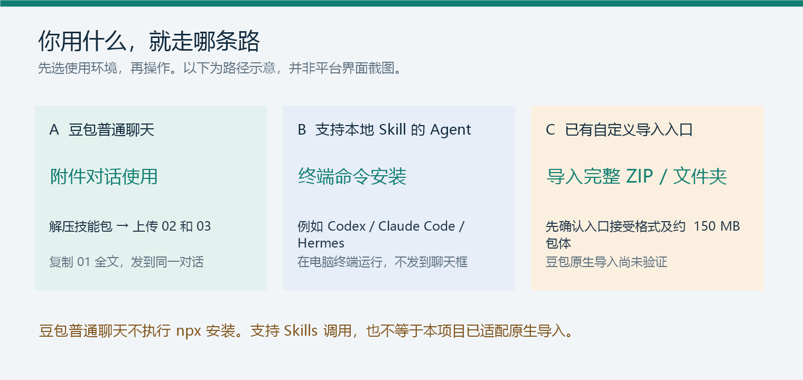
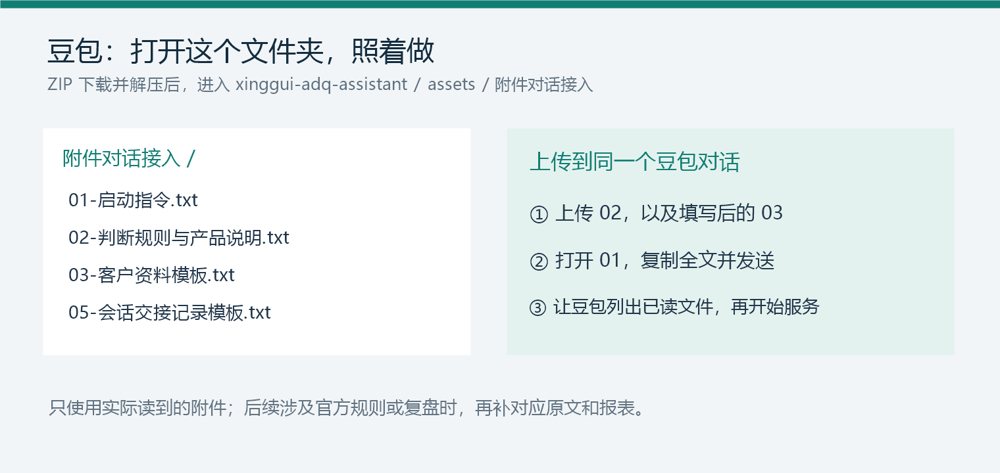
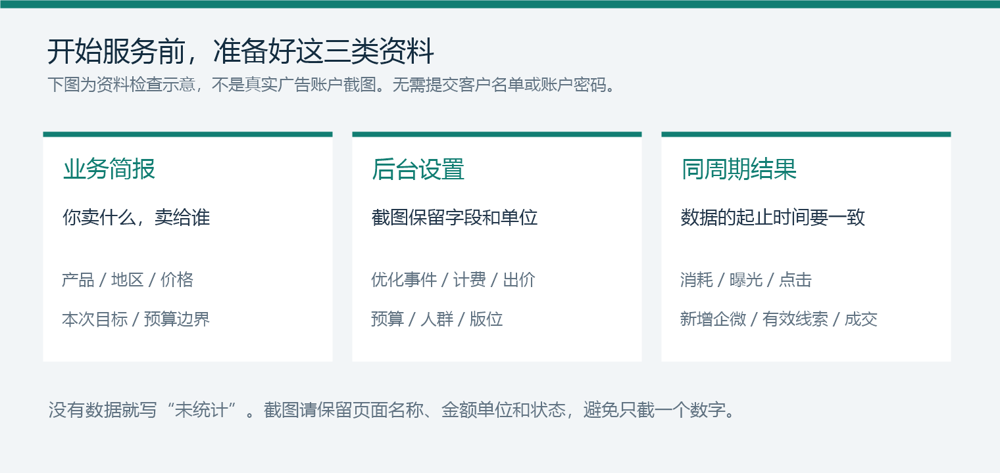

# 星轨投放助手

图文使用手册 · 2.1

先选使用方式，再开始投放服务。首次使用，重点看前两节。

## 01 / 选择你的使用方式



[下载完整技能包 · 约 150 MB](https://my.feishu.cn/file/FfLObjmb2otJsWxOmzqcbc0Mndd)

### 用豆包普通聊天？按这张图操作



1. 下载 ZIP 并解压，打开 xinggui-adq-assistant → assets → 附件对话接入。
2. 上传 02-判断规则与产品说明.txt 和填写后的 03-客户资料模板.txt。
3. 打开 01-启动指令.txt，复制全文到同一个豆包对话，发送后让它列出已读文件。

> 豆包普通聊天不能通过这条 npx 命令安装 Skill。附件方式只使用已读资料，不会自动加载全部知识库；本项目尚未验证豆包原生 ZIP 导入。

附件读不到或被截断时，分段粘贴文本并核对已读内容。涉及腾讯规则时再补对应官方原文，需要复盘时补同周期报表。

### 用 Codex、Claude Code、Hermes 等本地 Agent？

电脑安装 Node.js LTS 和 Git，进入目标项目文件夹，在 PowerShell、命令提示符或终端运行：

```bash
npx -y skills add tonyliu2525-code/xinggui-adq-assistant -y
```

命令仅安装到安装器支持的目标。看终端实际结果与失败项，再在 Agent 中打开该项目并重新加载技能。需访问 npm 和 GitHub；网络超时可改用 ZIP。不要把命令发到普通聊天框。

### 已有自定义技能导入入口？

按入口要求导入 ZIP 或完整文件夹，保留 SKILL.md、references、scripts 和 assets。先确认入口接受约 150 MB 的包体。WorkBuddy 使用其明确提供的本地技能入口。

> 使用星轨投放助手。请读取 SKILL.md，列出实际读取的资料和当前可用工具，再开始本次投放服务。

验收：目标目录文件齐全，且助手能读到配套资料。只有“安装完成”的文字回复，不能证明已安装。已验证安装文件完整性，未逐一验证所有客户端内调用。

## 02 / 准备资料，发起第一次服务



业务简报写清行业、地区、产品价格、本次目标和预算边界。名单只提供类型、来源与规模，无需提供真实号码。没有结果数据就写“未统计”。

> 使用星轨投放助手。项目：【企业简称】；产品和地区：【】；本次目标：【】；预算与可接受成本：【】。附件为业务资料、后台截图和同周期报表。请先核对已读资料，再给出具体方案及关键缺口。

> 截图保留页面名称、字段、金额单位和状态。报表保留统计起止时间；分开记录成功添加企微、有效线索和成交。请勿提交账户密码或访问令牌。

## 03 / 这次要解决什么

| 场景 | 提供什么 | 可直接发送的要求 |
| --- | --- | --- |
| 开户准备 | 实际业务、主体、业务链接与资质 | 核对开户路径、资料缺口与官方依据。 |
| 曝光方案 | 名单匹配、人群、版位与曝光数据 | 提出具体设置和触达观察方案。 |
| 出价诊断 | 完整设置页、单位、预算与成本参考 | 指出需要调整的字段、理由和停止条件。 |
| 广告创意 | 品牌、价格、活动限制与可用图片 | 提供文案、画面布局和落地页承接建议。 |
| 投后复盘 | 上轮方案、变更时间与同周期报表 | 判断保留、调整或停止，并给下一轮动作。 |

助手提供建议，由账户负责人核对并在腾讯后台执行。没有历史依据时，先安排有消耗上限的验证，不把某个报价当成统一标准。

## 04 / 保存记录，下次接着用

> 请保存本项目服务记录：已确认业务、当前设置、统计周期、实际数据、本轮判断、已执行修改和时间、观察条件及待补资料。不能保存文件时，请输出可复制记录。

下次上传服务记录和最新报表，发送“使用星轨投放助手，继续本项目”。豆包附件对话可用 05-会话交接记录模板.txt 保存记录。

更换 Agent 或电脑时，项目记录需要另行带过去；对话历史和客户资料不会跟着 Skill 自动同步。更新技能前保留项目资料，遇到同名目录先确认冲突。

## 05 / 卡住时，先看这里

| 遇到的情况 | 下一步 |
| --- | --- |
| 豆包只解释命令 | 回到第 01 节，使用附件对话流程。 |
| ZIP 导入失败 | 核对入口是否支持自定义导入及包体大小；可改用附件资料。 |
| 找不到知识库或素材 | 确认完整 assets 目录仍在，检查 Agent 的文件访问权限。 |
| 终端下载超时 | 使用本手册的飞书 ZIP 下载链接。 |
| 图片看不清 / 脚本不能运行 | 补清晰截图或字段文字；可按表格继续分析，不假称脚本已执行。 |
| 新对话忘记前次结果 | 上传上次服务记录及最新资料。 |

## 06 / 需要查细节时

| 资料 | 技能包内位置 |
| --- | --- |
| 客户资料模板 | assets/project/投放服务/客户投放资料.md |
| 报表模板 | assets/project/投放服务/投放数据记录.csv |
| 素材参考 | assets/project/素材库/浏览素材库.html |
| 豆包附件资料 | assets/附件对话接入/ |

开户资格、具体流量准入与素材审核分别核对。涉及腾讯规则，应给出官方文章、原句、URL、更新时间和获取时间；现时有效性以腾讯规则为准。

平台能力以实际版本和权限为准。助手未连接腾讯账户 API，不代替开户、充值或发布；不保证审核通过或投放效果。公开素材仅作参考，商用前确认授权。

需要协助时，提供 Agent 名称与版本、安装方式、完整错误提示和当前任务。不要发送账户密码或真实客户名单。
